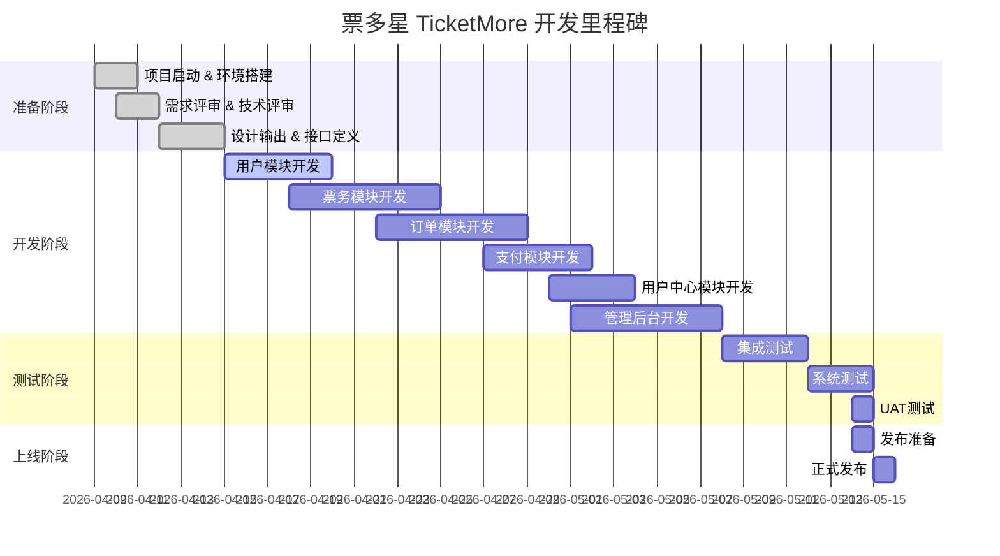

# 票多星 TicketMore 项目开发计划

| 文档信息 | 内容 |
|---------|------|
| 项目名称 | 票多星 TicketMore |
| 版本号 | V1.0 |
| 文档状态 | 正式发布 |
| 创建日期 | 2026-04-09 |
| 项目经理 | 软件研发项目经理 |
| 计划周期 | 2026-04-09 至 2026-05-15 |

---

## 1. 项目概述

### 1.1 项目背景

随着文化娱乐、体育赛事、旅游休闲等消费需求的持续增长，票务市场呈现快速增长态势。传统票务购买方式存在购票渠道分散、票源信息不透明、购票体验差等问题。用户需要一个一站式票务预订平台，能够便捷地浏览、比较和购买各类门票。

**票多星 (TicketMore)** 应运而生，旨在打造国内领先的票务预订平台，为用户提供安全、便捷、优惠的票务购买服务。

### 1.2 项目目标

| 目标类别 | 目标描述 | 验收标准 |
|---------|----------|----------|
| 功能目标 | 完成App端核心功能开发 | 所有P0功能通过测试 |
| 质量目标 | 代码规范执行，缺陷率≤1% | Code Review通过率≥95% |
| 性能目标 | 接口响应时间≤500ms | P99≤500ms压测通过 |
| 上线目标 | 按计划时间上线 | 2026-05-15完成发布 |

### 1.3 交付范围

#### V1.0版本范围

**App端功能：**
- 用户注册登录模块
- 首页推荐模块
- 票务浏览搜索模块
- 下单支付模块
- 订单管理模块
- 用户中心模块

**后端API：**
- 用户服务API
- 票务服务API
- 订单服务API
- 支付服务API
- 退款服务API
- 通知服务API

**管理后台：**
- 票品管理模块
- 订单管理模块
- 用户管理模块

---

## 2. 里程碑计划

### 2.1 阶段划分

### 2.2 里程碑详情

| 里程碑 | 计划日期 | 交付物 | 状态 |
|--------|----------|--------|------|
| M1 - 项目启动 | 2026-04-09 | 项目初始化、团队组建、环境搭建 | ✅ |
| M2 - 设计完成 | 2026-04-14 | 技术方案、接口文档、UI设计 | ✅ |
| M3 - 核心功能完成 | 2026-04-27 | 用户模块、票务模块、订单模块 | 🔄进行中 |
| M4 - 功能开发完成 | 2026-05-06 | 支付模块、用户中心、管理后台 | ⏳待开始 |
| M5 - 测试通过 | 2026-05-13 | 测试报告、缺陷修复、UAT通过 | ⏳待开始 |
| M6 - 正式上线 | 2026-05-15 | 发布包、部署文档、用户手册 | ⏳待开始 |

---

## 3. 开发计划

### 3.1 Sprint规划

#### Sprint 1: 基础架构与用户模块 (2026-04-15 ~ 2026-04-20)

| 任务ID | 任务描述 | 负责人 | 预计工时 | 优先级 |
|--------|----------|--------|----------|--------|
| T001 | 项目初始化、Spring Boot骨架搭建 | 后端开发 | 2天 | P0 |
| T002 | 数据库设计与初始化 | 后端开发 | 1天 | P0 |
| T003 | 用户注册登录API开发 | 后端开发 | 2天 | P0 |
| T004 | 用户信息管理API开发 | 后端开发 | 1天 | P0 |
| T005 | React Native项目初始化 | 前端开发 | 1天 | P0 |
| T006 | 登录注册页面开发 | 前端开发 | 2天 | P0 |
| T007 | 个人中心页面基础框架 | 前端开发 | 1天 | P0 |
| T008 | 用户模块接口联调 | 前后端协作 | 1天 | P0 |

#### Sprint 2: 票务模块 (2026-04-21 ~ 2026-04-27)

| 任务ID | 任务描述 | 负责人 | 预计工时 | 优先级 |
|--------|----------|--------|----------|--------|
| T009 | 票务列表API开发 | 后端开发 | 2天 | P0 |
| T010 | 票务详情API开发 | 后端开发 | 1天 | P0 |
| T011 | 座位选择API开发 | 后端开发 | 2天 | P0 |
| T012 | 搜索筛选API开发 | 后端开发 | 1天 | P0 |
| T013 | 首页开发 | 前端开发 | 2天 | P0 |
| T014 | 票品列表页开发 | 前端开发 | 1天 | P0 |
| T015 | 票品详情页开发 | 前端开发 | 2天 | P0 |
| T016 | 座位选择页面开发 | 前端开发 | 2天 | P0 |
| T017 | 搜索页面开发 | 前端开发 | 1天 | P1 |

#### Sprint 3: 订单与购物车模块 (2026-04-28 ~ 2026-05-04)

| 任务ID | 任务描述 | 负责人 | 预计工时 | 优先级 |
|--------|----------|--------|----------|--------|
| T018 | 购物车API开发 | 后端开发 | 2天 | P0 |
| T019 | 创建订单API开发 | 后端开发 | 2天 | P0 |
| T020 | 订单列表详情API | 后端开发 | 1天 | P0 |
| T021 | 取消订单API开发 | 后端开发 | 1天 | P0 |
| T022 | 购物车页面开发 | 前端开发 | 2天 | P0 |
| T023 | 订单确认页开发 | 前端开发 | 2天 | P0 |
| T024 | 订单列表页开发 | 前端开发 | 1天 | P0 |
| T025 | 订单详情页开发 | 前端开发 | 1天 | P0 |
| T026 | 优惠券API开发 | 后端开发 | 1天 | P0 |

#### Sprint 4: 支付与用户中心 (2026-05-05 ~ 2026-05-11)

| 发起支付API | 支付回调API开发 | 后端开发 | 2天 | P0 |
|-------------|-----------------|----------|-----|-----|
| T028 | 支付结果查询API | 后端开发 | 1天 | P0 |
| T029 | 退款API开发 | 后端开发 | 2天 | P0 |
| T030 | 通知服务API | 后端开发 | 1天 | P1 |
| T031 | 支付页面开发 | 前端开发 | 2天 | P0 |
| T032 | 支付结果页开发 | 前端开发 | 1天 | P0 |
| T033 | 用户中心页开发 | 前端开发 | 2天 | P0 |
| T034 | 优惠券页开发 | 前端开发 | 1天 | P0 |
| T035 | 收藏管理页开发 | 前端开发 | 1天 | P1 |

#### Sprint 5: 管理后台与测试 (2026-05-12 ~ 2026-05-15)

| 任务ID | 任务描述 | 负责人 | 预计工时 | 优先级 |
|--------|----------|--------|----------|--------|
| T036 | 管理后台-票品管理 | 后端开发 | 3天 | P0 |
| T037 | 管理后台-订单管理 | 后端开发 | 2天 | P0 |
| T038 | 管理后台-用户管理 | 后端开发 | 1天 | P1 |
| T039 | 管理后台前端开发 | 前端开发 | 4天 | P0 |
| T040 | 系统集成测试 | 测试团队 | 3天 | P0 |
| T041 | 缺陷修复与回归 | 全体 | 2天 | P0 |
| T042 | UAT测试 | 测试/产品 | 1天 | P0 |
| T043 | 发布准备与部署 | 运维 | 1天 | P0 |

---

## 4. 工时估算

### 4.1 总工时统计

| 角色 | 投入人力 | 预计工时(人天) | 占比 |
|------|----------|----------------|------|
| 后端开发 | 1人 | 30天 | 45% |
| 前端开发 | 1人 | 25天 | 38% |
| 测试工程师 | 1人 | 8天 | 12% |
| UI设计师 | 1人 | 3天 | 5% |
| **合计** | 4人 | **66天** | 100% |

### 4.2 模块工时分布

| 模块 | 后端工时 | 前端工时 | 测试工时 | 小计 |
|------|----------|----------|----------|------|
| 用户模块 | 5天 | 3天 | 1天 | 9天 |
| 票务模块 | 6天 | 7天 | 2天 | 15天 |
| 订单模块 | 5天 | 5天 | 1天 | 11天 |
| 支付模块 | 5天 | 3天 | 1天 | 9天 |
| 用户中心 | 2天 | 4天 | 1天 | 7天 |
| 管理后台 | 6天 | 3天 | 2天 | 11天 |
| 环境与基础设施 | 1天 | 0天 | 0天 | 1天 |

---

## 5. 风险评估

### 5.1 已知风险

| 风险项 | 影响程度 | 发生概率 | 应对策略 | 状态 |
|--------|----------|----------|----------|------|
| 第三方支付接口对接延迟 | 高 | 中 | 准备Mock支付方案 | 监控中 |
| 热门票并发超卖问题 | 高 | 低 | 乐观锁+分布式锁双重保护 | 已识别 |
| 选座性能问题 | 中 | 中 | 预加载座位图+CDN加速 | 预案中 |
| 第三方登录资质申请 | 中 | 中 | 先开发手机号登录 | 跟踪中 |
| 测试设备兼容性 | 低 | 中 | 采购多型号测试机 | 已采购 |

### 5.2 风险监控机制

1. **每日站会**：同步进度和阻塞问题
2. **周报**：每周五发布项目周报，评估风险状态
3. **关键节点评审**：每个里程碑点进行评审确认

---

## 6. 沟通机制

### 6.1 会议安排

| 会议类型 | 频率 | 参会人员 | 时长 |
|----------|------|----------|------|
| 每日站会 | 每日 | 全体开发 | 15分钟 |
| Sprint规划 | 每周一 | PM+开发+测试 | 30分钟 |
| Sprint评审 | 每周五 | PM+全体 | 30分钟 |
| 需求评审 | 按需 | PM+产品+开发 | 60分钟 |
| 技术评审 | 按需 | PM+后端+前端 | 60分钟 |

### 6.2 沟通渠道

- 日常沟通：企业微信群
- 文档协作：项目文档库
- 代码协作：GitLab仓库

---

## 7. 验收标准

### 7.1 功能验收

| 模块 | 验收条件 | 测试标准 |
|------|----------|----------|
| 用户模块 | 注册、登录、找回密码正常 | 测试用例通过率100% |
| 票务模块 | 列表、详情、搜索、选座正常 | 测试用例通过率100% |
| 订单模块 | 购物车、订单、取消功能正常 | 测试用例通过率100% |
| 支付模块 | 微信/支付宝支付、回调正常 | 测试用例通过率100% |
| 用户中心 | 个人信息、优惠券、收藏正常 | 测试用例通过率100% |

### 7.2 性能验收

| 指标 | 验收标准 |
|------|----------|
| App首屏加载 | ≤2秒 |
| 页面切换响应 | ≤300ms |
| 接口响应时间 | P99≤500ms |
| 并发能力 | 1000并发压测通过 |

### 7.3 安全验收

| 项目 | 验收标准 |
|------|----------|
| 渗透测试 | 无高危漏洞 |
| 数据加密 | 敏感信息加密存储 |
| 权限控制 | 基于角色权限管控 |

---

## 8. 版本历史

| 版本 | 日期 | 变更内容 | 作者 |
|------|------|----------|------|
| V1.0 | 2026-04-09 | 初始版本 | 项目经理 |

---

**文档签署**

| 角色 | 姓名 | 日期 | 签字 |
|------|------|------|------|
| 项目经理 | | 2026-04-09 | |
| 产品经理 | | 2026-04-09 | |
| 开发负责人 | | 2026-04-09 | |
| 测试负责人 | | 2026-04-09 | |
